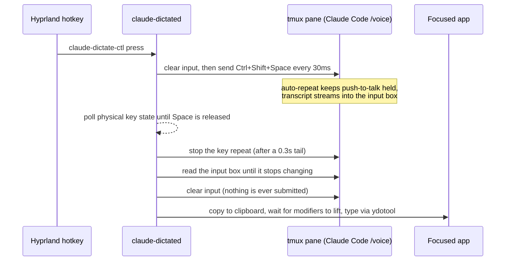

# claude-dictate

System-wide push-to-talk dictation for Linux, powered by Claude Code's `/voice` mode.

Hold a hotkey, speak, let go, and the transcript gets typed into whatever window has focus. Under the hood a hidden Claude Code session does the speech-to-text, and claude-dictate reads the result back out of its input box before anything is ever submitted.

```
hold Super+Space ──▶ chime ──▶ speak ──▶ release ──▶ chime ──▶ text appears in your focused app
```

## Why

Claude Code ships with solid voice transcription, but it only types into its own prompt. claude-dictate turns it into a dictation engine for every app on your desktop, so you can talk into your browser, editor, chat client or terminal with the same transcription quality and no extra API keys.

## How it works



A few details that matter:

- **The engine lives in tmux.** Claude Code runs in plan mode with no tools inside a private tmux server (`tmux -L claude-dictate`). Keys are sent as raw bytes with `send-keys -H`, because tmux strips Shift from Ctrl combos when forwarding them normally.
- **Push-to-talk is held through auto-repeat.** Claude Code detects a held key by its repeats, so resending the key sequence every ~33ms keeps recording going. No focus or synthetic keyboard is needed on the Claude side.
- **The transcript is scraped, not submitted.** `claude_dictate/transcript.py` finds the input box between the two horizontal rules of the TUI, drops the placeholder, the level meter and the line prefixes, and joins wrapped rows back together.
- **Release is read from the hardware.** Compositor release binds turned out to be unreliable, so the daemon polls the real key state of every physical keyboard via evdev (`EVIOCGKEY`). The release command from the window manager is only a backup, and a 60 second watchdog caps any hold.
- **Typing is guarded.** Text is typed only once no modifier is physically held, so the injected keys can never combine with a held Super or Ctrl into a shortcut. If the key state can't be read, nothing is typed. Every transcript is also copied to the clipboard, so you never lose what you said.

For a visual walkthrough, open [`docs/architecture.html`](docs/architecture.html) in a browser.

## Requirements

- Linux on Wayland (developed on Arch with Hyprland)
- [Claude Code](https://docs.claude.com/en/docs/claude-code) v2.1.69 or newer, signed in with a Claude.ai account
- A working microphone
- Python 3.10+ (standard library only, no pip install needed)
- `tmux`, `kitty`, `ydotool`, `wl-clipboard`, `pipewire` (for `pw-play`) and `libnotify` (for `notify-send`)
- Your user in the `input` group, so the daemon can read keyboard state from `/dev/input`

On Arch:

```sh
sudo pacman -S tmux kitty ydotool wl-clipboard pipewire libnotify
sudo usermod -aG input "$USER"   # log out and back in afterwards
systemctl --user enable --now ydotool.service   # or any other way of keeping ydotoold running
```

## Setup

### 1. Turn on voice mode once

Start the session in a visible kitty window and enable dictation inside Claude Code:

```sh
./bin/claude-dictate-start
```

Then type `/voice` in the Claude Code prompt. The setting persists, so this is a one-time step. Hold `Ctrl+Shift+Space`, say something, and let go to check that text shows up in the input box.

### 2. Bind push-to-talk to `Ctrl+Shift+Space`

The daemon drives Claude Code with `Ctrl+Shift+Space`, so add this to `~/.claude/keybindings.json`:

```json
{
  "bindings": [
    {
      "context": "Chat",
      "bindings": {
        "ctrl+shift+space": "voice:pushToTalk"
      }
    }
  ]
}
```

### 3. Install the commands and systemd units

```sh
./scripts/install-systemd.sh
```

This symlinks `claude-dictate-start`, `claude-dictated` and `claude-dictate-ctl` into `~/.local/bin`, links both user units from `systemd/`, and enables the daemon.

If your desktop activates `graphical-session.target` (GNOME, KDE, uwsm) the daemon starts on login. Plain Hyprland, Sway and river don't, so start it from your compositor's autostart instead. For Hyprland:

```ini
exec-once = systemctl --user import-environment WAYLAND_DISPLAY HYPRLAND_INSTANCE_SIGNATURE && systemctl --user start claude-dictated.service
```

### 4. Add the global hotkey

The daemon watches the physical **Space** key for release, so use any combo that includes Space. For Hyprland:

```ini
bind  = SUPER, Space, exec, ~/.local/bin/claude-dictate-ctl press
bindr = SUPER, Space, exec, ~/.local/bin/claude-dictate-ctl release
```

Now hold `Super+Space` anywhere, talk, and let go.

## Usage

| Command | What it does |
| --- | --- |
| `claude-dictate-ctl press` | Start recording (replies `recording`, or `busy` if a dictation is already running) |
| `claude-dictate-ctl release` | Stop recording and deliver the transcript |
| `claude-dictate-ctl status` | Print `idle`, `recording` or `finishing` |
| `claude-dictate-start` | Start the tmux session if needed and attach a kitty window to it |
| `claude-dictate-start --detached` | Start the session without opening a window |

You'll hear a chime when recording actually starts and another when it stops. Errors show up as desktop notifications, and if typing was skipped the notification tells you the transcript is waiting on your clipboard.

To peek at the hidden Claude Code session at any time:

```sh
tmux -L claude-dictate attach -t claude-dictate
```

### Logs and service control

```sh
journalctl --user -u claude-dictated -f
systemctl --user restart claude-dictated.service
systemctl --user restart claude-dictate-session.service
```

The session unit restarts Claude Code automatically if it exits, and the daemon keeps running across those restarts.

## Configuration

| Setting | Default | Where |
| --- | --- | --- |
| Working directory of the Claude session | `~/.local/share/claude-dictate` | `CLAUDE_DICTATE_WORKDIR` env var |
| Control socket | `$XDG_RUNTIME_DIR/claude-dictate.sock` | `claude_dictate/ipc.py` |
| Maximum hold before auto-release | 60s | `MAX_HOLD_SECONDS` in `claude_dictate/dictator.py` |
| Extra recording after key release | 0.3s | `RELEASE_TAIL_SECONDS` in `claude_dictate/dictation.py` |
| Quiet time before the transcript counts as final | 1.0s | `QUIET_SECONDS` in `claude_dictate/dictation.py` |
| Chimes | `assets/sounds/*.wav` | swap the files to change them |

The release tail exists because cutting the recording right at key-up clipped the last word. Lowering the quiet window makes text appear sooner, at the risk of grabbing it before the last words land.

## Known limitations

- **ASCII only when typing.** ydotool can only press keys that exist on the keyboard layout, so smart quotes and dashes become their ASCII versions and other non-ASCII characters are dropped. The clipboard always keeps the original text.
- **Built for Wayland + Hyprland.** Clipboard and typing rely on `wl-copy` and `ydotool`. Other compositors should work with their own hotkey bindings, but they haven't been tested.
- **Screen scraping.** The transcript is read from Claude Code's rendered TUI. A future Claude Code release that changes the input box layout could break the parser in `claude_dictate/transcript.py`.
- **One dictation at a time.** A press during an ongoing dictation is answered with `busy`.

## Development

Run the test suite (no microphone or session needed):

```sh
python3 -m unittest discover -s tests
```

Handy scripts for working against a live session:

```sh
python3 scripts/dictate_once.py            # speak, press Enter, print the transcript and latency
python3 scripts/dictate_once.py --hold 5   # release automatically after 5 seconds
python3 scripts/probe_dictation.py         # record every frame of the pane during a dictation
```

### Project layout

```
bin/                    entry points (session launcher, daemon, control client)
claude_dictate/
  session.py            tmux control: send raw keys, capture the pane
  transcript.py         parse the input box out of the rendered TUI
  dictation.py          one push-to-talk cycle, from clear to final text
  dictator.py           press/release state machine and safe delivery
  keyboard.py           physical key state through evdev
  daemon.py             Unix socket server and notifications
  ctl.py, ipc.py        control client and socket protocol
  typers/               text injection backends (ydotool)
  clipboard.py, sounds.py
systemd/                user units for the session and the daemon
scripts/                installer and debugging tools
tests/                  unit tests
docs/architecture.html  visual architecture overview
```
